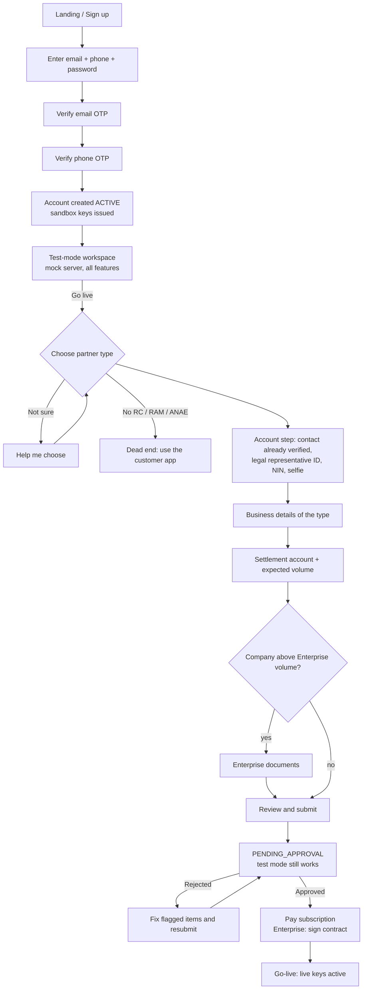
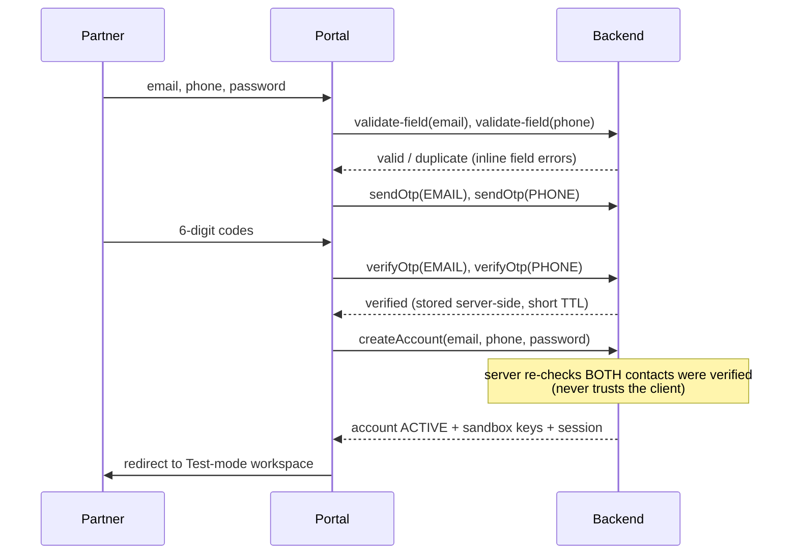

# Partner auth & onboarding – "test first, go live when verified"

Status: **design proposal**. Nothing in this document is implemented yet.
It builds on the tiered signup that already exists in this repo (ClickUp 869fcne3g) and changes *when* each part of it happens.

Legend used below: **[reuse]** = already built, used as is · **[change]** = built, must change · **[new]** = not built.

---

## 1. Goal in one paragraph

Anyone can create a Partner account with **only an email and a phone number, both verified by a 6-digit code** (plus a password). The account gives immediate access to **Test mode**: a sandbox with a mock server where the partner can log in fast and try **every** product with fake data and no paperwork. To use **Live (production)**, the partner goes through **Verification**: first choose the right **partner type** (Auto-entrepreneur, Individual trader, Company, Enterprise), complete that type's account/legal-representative and business forms, get approved by an admin, and **pay the subscription**. Only when both are true do the live API keys and live features switch on.

What changes compared with today's build:

| Today (built) | Proposed |
|---|---|
| Step 1 picks the type **before** any account exists. Step 2 mixes contact verification, password **and** legal-representative identity (ID, NIN, selfie). | Account creation is one light screen: email + phone (OTP) + password. **No type, no ID, no documents.** The existing **5-step stepper and first screen are kept as the Verification flow** (section 5.4). |
| The account is a `DRAFT` signup. It cannot do anything until the whole form is approved. | The account is immediately **useful**: Test mode, sandbox keys, mock data. |
| Approval = go-live. No payment. | Go-live = **approved verification AND active subscription** (Enterprise: signed contract instead). |
| Type choice, helper and "no legal status" screen are the entry of the signup. | They become the **entry of the Verification flow**, reachable from the Test-mode workspace. |

---

## 2. Concepts and vocabulary

| Term | Meaning |
|---|---|
| **Account** | The login identity: verified email, verified phone, password. Exists only once both contacts are verified. One account = one partner organisation (team users are a Company+ feature, out of scope here). |
| **Test mode** | Sandbox environment. Test keys (`sk_test_…`), fake money, mock server. Always available to an active account. |
| **Live mode** | Production environment. Live keys (`sk_live_…`), real money. Available only after go-live. |
| **Verification** | The KYC/KYB process (type → account & legal representative → business → settlement → review → admin decision → subscription). Also called "Go live" in the UI. |
| **Subscription** | The recurring fee that keeps Live mode on. Plans and prices are TBD (Risk/Finance). |
| **Go-live** | The moment Live mode is enabled: `verification = APPROVED` **and** `subscription = ACTIVE` (or `BY_CONTRACT` + contract signed for Enterprise). |
| **Partner type** | `AUTO_ENTREPRENEUR`, `INDIVIDUAL_TRADER`, `COMPANY`, `ENTERPRISE`. Decides the verification form, the products and the KYC level. Config-driven **[reuse]** (`src/shared/config/partnerTypes.ts`). |
| **Declared volume band** | Decides limits and routes a Company to Enterprise **[reuse]**. |

---

## 3. The three independent states

The old single `MerchantStatus` tried to describe everything. The new model separates three things, so each one can change without confusing the others.

### 3.1 Account state (auth)

```
(no account) ──verify email + phone, set password──▶ ACTIVE ──admin / user──▶ SUSPENDED | CLOSED
```

- An account **never exists unverified**. Unverified attempts live only in a short-lived *signup session* (see 5.1). This keeps the user table clean and makes "verified email + phone" an invariant, not a flag to check.
- `SUSPENDED` (fraud, abuse): login refused, both modes off. `CLOSED`: user-requested, data retained per policy.

### 3.2 Verification state (KYC/KYB)

| State | Meaning | Maps to existing `MerchantStatus` / KYB |
|---|---|---|
| `NOT_STARTED` | Account has never opened "Go live". **No merchant record exists.** | – (new) |
| `IN_PROGRESS` | Partner picked a type and is filling steps. Progress saved per step. | `DRAFT` / no KYB |
| `PENDING_APPROVAL` | Submitted. Waiting for admin. | `PENDING_APPROVAL` / `PENDING` |
| `REJECTED` | Admin rejected with reason + flagged fields. Partner can fix and resubmit. | `REJECTED` / `REJECTED` |
| `APPROVED` | Identity and business verified. KYC level 2 (or 3 for Enterprise) assigned, limits for type + band applied. | `APPROVED` / `APPROVED` |

Transitions (**[reuse]**, `src/shared/flow` `TRANSITIONS`, plus the new first edge):

```
NOT_STARTED ─choose type─▶ IN_PROGRESS ─submit─▶ PENDING_APPROVAL ─approve─▶ APPROVED
                                                       │  ▲
                                                reject │  │ resubmit (flagged items only)
                                                       ▼  │
                                                    REJECTED
```

### 3.3 Subscription state **[new]**

| State | Meaning |
|---|---|
| `NONE` | No subscription (default). |
| `PENDING_PAYMENT` | Verification approved; partner must pay. |
| `ACTIVE` | Paid and in period. |
| `PAST_DUE` | Renewal failed. Grace period (`SUBSCRIPTION_GRACE_DAYS`, TBD) runs; Live still on, banner shown. |
| `SUSPENDED` | Grace over. **Live keys deactivated.** Test mode keeps working. Paying again reactivates instantly. |
| `CANCELLED` | Partner cancelled; Live off at period end. |
| `BY_CONTRACT` | Enterprise: fee set by contract, invoiced outside the self-serve checkout. |

### 3.4 The one rule that connects them

```
liveEnabled = account == ACTIVE
          AND verification == APPROVED
          AND ( subscription == ACTIVE | PAST_DUE(in grace)
                | (subscription == BY_CONTRACT AND contractSignedAt != null) )
          AND NOT transactionsBlocked   // AE cap, if AE_CAP_BEHAVIOUR == BLOCK
```

This extends today's `goLiveBlocked` (Enterprise contract) **[change]**. Everything else in the product asks `liveEnabled`, never the individual states.

---

## 4. End-to-end user journey



Key property: **at every point after E the partner can leave Verification and keep using Test mode.** Nothing in Verification blocks the sandbox.

---

## 5. Flow details

### 5.1 Create an account (light signup) **[new screen, reuse parts]**

Screen: `/signup` – a single card, no stepper, no type.

| Field | Rule |
|---|---|
| Email | Format check on blur **[reuse validator]**; "already registered" check on blur **[reuse `validate-field`]**. OTP code, 6 digits **[reuse `OtpField`]**. |
| Phone | `+213` prefix, national number format **[reuse validator]** (format is a placeholder, TODO compliance). Duplicate check. OTP code. |
| Password | Policy placeholder (>= 8 chars) + strength meter **[reuse `PasswordField`]**. |

Sequence (the mock already does steps 2–4 correctly **[reuse]**):



Rules:
- **Order is free** (email first or phone first) but **Create account stays disabled until both show "Verified"**. The server enforces it too.
- Changing a verified value un-verifies it **[reuse]**.
- Each OTP: 6 digits, **TTL 10 min** (TBD), **max 5 wrong attempts** then a 15-min lock on that value, **max 5 sends per value per hour** (TBD). Mock code is `123456` **[reuse]**.
- No documents, no type, no ID at this stage. That is the whole point.

### 5.2 Log in (fast) **[change]**

- Identifier: **email or phone** + password. (Today login is email only.)
- After login the partner lands in the **Test-mode workspace**, not on a form.
- "Fast": session lasts 30 days on a trusted device (refresh token, TBD); no re-verification of contacts after signup.
- Forgot password: OTP to the verified email **or** phone → set a new password **[new]**.
- Optional later: passwordless login by phone OTP. Not required for v1.
- Throttling: 5 failed logins → progressive delay; generic error "Email/phone or password is incorrect" (no hint which one) **[reuse pattern]**.

### 5.3 Test mode **[new]**

Purpose: let a partner evaluate and integrate **before** any paperwork.

What the partner gets immediately:
- **Sandbox API keys** (`sk_test_…`) **[reuse: issued at account creation]**, viewable and re-rollable.
- A **mock server**: a sandbox API that behaves like production but moves no money and uses fake data. The partner can call it from their own code or use the portal's test tools.
- **All products enabled in Test mode, regardless of partner type** (payment links, invoices, QR, website checkout, POS, API, refunds, team users, sub-merchants, custom pricing preview). The type only gates **Live** features (the Products column of the type table **[reuse]**). Rationale: the type is not known yet, and trying everything helps the partner pick the right one.
- **Test controls** (proposed): magic amounts/values to force success, decline, timeout and refund; "simulate a payment" button; webhook tester; a **Reset test data** button.
- A permanent **Test mode banner** and a mode switch in the header (`Test | Live`); Live is disabled with a "Go live" call to action until `liveEnabled`.

Hard separation between modes:
- Separate data stores, keys and webhooks. A test key can never touch live data and vice versa.
- Test data is **clearly watermarked** in the UI ("TEST") and in API responses (`livemode: false`).
- No limits from the type/band table apply in Test mode (only fair-use rate limits).
- Test mode never expires because verification is pending, rejected or the subscription lapsed.

Workspace home (`/app`) shows:
1. Test keys + quick start.
2. Test tools (links, invoices, QR, API console…).
3. A **"Go live" checklist card** with the live-readiness steps and their state (see 5.4–5.7).

### 5.4 Start verification: step 1 = the existing "Choose your partner type" screen **[reuse as is]**

The first step of Verification is **the screen that is already deployed** at today's `/signup` (`TypeStep`), unchanged in layout and copy. It opens from the Go-live card, the Test-mode banner, or `/verify`.

The stepper and header are exactly:

```
 Mizaniya Pay                     Step 1 of 5
 1  Partner type   (current)      Choose your partner type
 2  Account                       Your legal status decides which form you fill.
 3  Business
 4  Settlement
 5  Review
 "Your progress is saved after every step."            FR | AR | EN
```

- **Four cards**: Auto-entrepreneur · Individual trader or artisan · Company · Enterprise. Each has a one-line description, "You'll need: …" and product chips (Payment links, Invoices, QR payments, Website checkout, POS, API, Team users, Refunds, Custom pricing, Sub-merchants, Dedicated support, as per the type's products).
- The selected card gets the yellow ring and the **Selected** badge; the button reads **"Continue as {type}"** (e.g. "Continue as Individual trader or artisan"), disabled until a card is selected.
- Under the cards: **Help me choose** → helper (RC? RAM? ANAE card?) · **No registered business yet?** → dead end with the customer-app link and anae.dz (Verification only; Test mode keeps working) · **Already a partner? Log in** (shown only on the public entry, hidden when the partner is already logged in).
- The helper preselects the type and shows "Based on your answers we suggested …"; the partner can still change it.
- **Changing type later**: confirmation popup, shared data kept, type-specific fields reset **[reuse `changePartnerType`]**.
- "Step N of M": 5 steps for AE / Individual trader / Company, 6 for Enterprise (adds Enterprise documents before Review), and 6 or 7 including the new Subscription step (section 5.7). A Company above the Enterprise volume threshold gets the extra step once its band is chosen **[reuse]**.

Differences from today, all behind the screen:
- The partner is **already logged in** with a verified account, so choosing a type **creates the merchant record** (`verification: IN_PROGRESS`, `merchant.status = DRAFT`) via `startVerification`, instead of being kept locally before an account exists.
- Account (step 2) is **not** shown as done just because the account exists: it is checked ✓ only when the legal-representative part has been saved (`lastCompletedStep` stays empty after signup).

### 5.5 Verification steps **[reuse, re-ordered]**

Steps per type, config-driven **[reuse]**, same ids and order as today. Only the **Account** step changes: its contact/password part has moved to signup (5.1), so inside Verification it shows the verified email and phone **read-only** and asks only for the legal representative.

| # | Step id | Content | Source |
|---|---|---|---|
| 1 | `type` | Choose type | reuse |
| 2 | `account` | **Account & legal representative.** Contact section: email + phone shown as *Verified*, read-only (changing them is an account-settings action, not part of Verification). Legal representative section as built: full name, role (Company/Enterprise only), ID type CNI/passport + front/back, NIN (monospace, duplicate check), selfie (camera). No password field (set at signup). | **change (small)**: drop the contact/password section, keep `legalRep` |
| 3 | `business` | Type-specific form: AE (ANAE card, activity from nomenclature, 5,000,000 DZD cap notice) · Trader (RC/RAM, NIF) · Company/Enterprise (RC, NIF, NIS, statuts, owners, delegation if rep ≠ manager). `.com.dz` rule for online sales | reuse |
| 4 | `settlement` | RIB or CCP, holder-name check (warn for AE/trader, **block** for Company/Enterprise), declared volume band + average ticket | reuse |
| 4b | `enterpriseDocs` | Delegation, financial statements, AML questionnaire, technical contact, sub-merchants question. Added for Enterprise, and for a Company whose band is above `ENTERPRISE_VOLUME_THRESHOLD` | reuse |
| 5 | `review` | One card per step with Edit, documents list, declarations, **Submit** | reuse |

Mechanics that stay exactly as built:
- Every step: trigger → loading → success/fail, **errors inline** under the field, error summary, `aria-invalid`/`aria-describedby`, **no toasts**.
- Field-level validation on blur: format + duplicate check for RC, NIF, NIS, NIN, AE card, RIB, CCP (email/phone were already checked at signup) **[reuse]**.
- Upload tiles (empty / uploading / uploaded / error), JPG/PNG/PDF ≤ 5 MB **[reuse]**.
- Save after every step; leave and resume at the first incomplete step on next login **[reuse]**.
- Server re-validates every step on save and on submit with the same shared schema **[reuse]**.

What is simpler now: **uploads always have a session** (the account exists), so the "uploads before the account exists need a pre-signup token" caveat from the build notes **disappears** **[change: removes a handoff item]**.

### 5.6 Submit, review, decision **[reuse]**

- Submit → `verification = PENDING_APPROVAL`, merchant `PENDING_APPROVAL`, KYB `PENDING`. Confirmation screen with expected review time (placeholder 48 h).
- Admin: list under KYC Level 2 / 3 with Partner-type filter, type-specific checklist, document preview popup, declared band, ANAE code, audit log **[reuse]**.
- **Approve** → verification `APPROVED`, KYC level and limits applied, partner notified. **Live keys are created but stay INACTIVE** until the subscription is paid (Enterprise: until the contract is marked signed, as today) **[change]**.
- **Reject** → reason code + free text mandatory, flagged fields optional, shown in the portal and e-mailed. "Fix and resubmit" reopens only flagged items **[reuse]**.
- While PENDING or REJECTED, **Test mode is fully usable**.

### 5.7 Pay the subscription **[new]**

When: right after `APPROVED`. (Alternative: pay at submit and refund on rejection – rejected because it charges people who may fail verification; see open question Q1.)

Screen: `/verify/payment` (also reachable from the Go-live card), step "Subscription" in the stepper after Review:

1. **Plan summary**: plan for the partner's type (and band, if pricing depends on it), billing period, price in DZD, what Live unlocks (the type's products), renewal date.
2. **Pay**: payment method (TBD: bank card via the Algerian interbank network, Algérie Poste, bank transfer with reference… see Q2). Pay button with loading state; success screen; **inline error** on decline with retry (no toast).
3. **Result**: subscription `ACTIVE` → live keys `ACTIVE` → "You're live" screen with the live key and next steps. Receipt/invoice available in the portal and by e-mail.

Rules:
- Enterprise: this step shows "Pricing by contract" and waits for **Mark contract as signed** (admin) instead of a checkout **[reuse existing contract flow]**.
- Renewal: automatic where the payment method allows; otherwise reminders at T-7, T-3, T-1 days (TBD) by e-mail/portal.
- Failed renewal → `PAST_DUE` → grace → `SUSPENDED` (Live off, Test on).
- **Type change / upgrade** (e.g. AE → Company): the existing upgrade flow **[reuse]** creates a second draft; on approval the plan changes. Proration/credit is a pricing decision (Q4).
- Cancellation: self-serve, effective at period end; Live off after.

---

## 6. Screens and routes

| Route | Screen | Status |
|---|---|---|
| `/signup` | Create account (email, phone, password, OTPs) | **new** (replaces today's step 2 + OTP bits) |
| `/login` | Email **or** phone + password; forgot password link | **change** |
| `/forgot-password` | OTP to email/phone → new password | **new** |
| `/app` | Test-mode workspace: keys, test tools, Go-live checklist, mode switch | **new** |
| `/verify` | Type selection + Help me choose + dead end | **moved** from `/signup` |
| `/verify/:stepId` | `account`, `business`, `settlement`, `enterpriseDocs`, `review` | **moved** (same step ids, new path prefix) |
| `/verify/payment` | Subscription | **new** |
| `/status` | Application status: timeline, rejection + fix, approved view, subscription card, AE cap, upgrade | **change** (adds subscription + test/live) |
| `/status/fix` | Fix and resubmit flagged items | reuse |
| `/admin`, `/admin/:id` | Review list/detail | **change** (adds subscription column/filters) |

Layout rules unchanged **[reuse]**: navy 300 px sidebar with stepper, 760 px centered column, phone width stacks. The signup screen has no stepper. The verification stepper is the existing one: `Partner type · Account · Business · Settlement · (Enterprise docs) · Review`, plus `Subscription` as the last item (section 5.7). "Step N of M" counts those.

Persistent UI:
- **Mode switch** `Test | Live` in the header; **Test banner** when in Test (yellow, "Test mode – no real money").
- **Go-live checklist** (in `/app` and `/status`): `1 Account ✓` · `2 Verification: <state>` · `3 Subscription: <state>` · `→ Live`.

---

## 7. Data model changes (frontend types + backend)

```ts
// Account (new – today it is implicit in the draft)
interface Account {
  id: string
  email: string;  emailVerifiedAt: string      // always set: invariant
  phone: string;  phoneVerifiedAt: string      // always set: invariant
  passwordHash: string                         // never plain text (the mock stores it in clear text on purpose)
  status: 'ACTIVE' | 'SUSPENDED' | 'CLOSED'
  createdAt: string
  lastLoginAt: string | null
}

// Verification (today's merchant + KYB, created lazily)
interface Verification {
  accountId: string
  state: 'NOT_STARTED' | 'IN_PROGRESS' | 'PENDING_APPROVAL' | 'REJECTED' | 'APPROVED'
  partnerType: PartnerType | null              // set when the partner picks a type
  draft: PartnerDraft                          // existing shape: steps[stepId][field], lastCompletedStep
  rejection: { code; text; flaggedFields[] } | null
  kycLevel: 2 | 3 | null
  // existing: volume band, settlement, AE/trader/company/enterprise fields, contract fields…
}

// Subscription (new)
interface Subscription {
  accountId: string
  state: 'NONE' | 'PENDING_PAYMENT' | 'ACTIVE' | 'PAST_DUE' | 'SUSPENDED' | 'CANCELLED' | 'BY_CONTRACT'
  planId: string | null                        // from SUBSCRIPTION_PLANS config
  currentPeriodStart / currentPeriodEnd: string | null
  graceEndsAt: string | null
  paymentMethod: …                             // TBD
}

// API keys: add environment gating
interface ApiKey { env: 'SANDBOX' | 'LIVE'; status: 'ACTIVE' | 'INACTIVE'; … }   // [reuse]
```

Derived, never stored: `liveEnabled` (3.4) and `mode` availability.

Config **[new, in `src/shared/config/tbd.ts` with `TODO(compliance)`/`TODO(finance)` comments – never hardcoded]**:

| Config | Meaning | Placeholder |
|---|---|---|
| `SUBSCRIPTION_PLANS` | Plan per type/band: id, price DZD, period | obviously fake values |
| `SUBSCRIPTION_PAYMENT_TIMING` | `AFTER_APPROVAL` (default) \| `AT_SUBMIT` | `AFTER_APPROVAL` |
| `SUBSCRIPTION_GRACE_DAYS` | Days Live stays on after a failed renewal | placeholder |
| `SUBSCRIPTION_REMINDER_DAYS` | Reminder offsets before renewal | `[7, 3, 1]` placeholder |
| `OTP_TTL_MINUTES`, `OTP_MAX_ATTEMPTS`, `OTP_MAX_SENDS_PER_HOUR`, `OTP_LOCK_MINUTES` | OTP hardening | placeholders |
| `SESSION_DAYS` | Trusted-device session length | 30 placeholder |
| `TEST_MODE_ALL_PRODUCTS` | Test mode enables all products | `true` |

Everything already in `tbd.ts` (volume bands, limits, Enterprise threshold, AE cap…) stays.

---

## 8. API contract

Existing endpoints **[reuse]** keep their shape. Changes and additions:

| Endpoint | Status | Notes |
|---|---|---|
| `validate-field {field,value}` | reuse | Also used on `/signup` for email and phone. |
| `sendOtp`, `verifyOtp` | **change** | Add TTL, attempt and send limits; return `retryAfterSeconds` on lock. |
| `createAccount {email, phone, password}` | **change** | Today it takes `{partnerType, data}`. Now only the three fields. Server verifies both OTPs. Returns session + sandbox keys. **No partner type.** |
| `login {identifier, password}` | **change** | `identifier` = email or phone. |
| `logout`, `getSession` | reuse | `getSession` returns account + verification + subscription summary + `liveEnabled`. |
| `forgotPassword`, `resetPassword` | **new** | OTP-based. |
| `getWorkspace` | **new** | Keys, test-mode info, go-live checklist. |
| `startVerification {partnerType}` | **new** | Creates the merchant record (`DRAFT`), sets type. Replaces `setPartnerType` for the first choice; `setPartnerType` remains for later changes. |
| `getDraft`, `saveStep`, `uploadDocument`, `searchAnaeActivities` | reuse | `saveStep` step ids unchanged (`account`, `business`, …). |
| `submit`, `resubmit`, `getPartnerStatus` | reuse / **change** | Status adds `subscription` and `liveEnabled`. |
| `startUpgrade`, `updateDeclaredVolume`, `checkPaymentCategory` | reuse | |
| `getSubscriptionQuote` | **new** | Plan + price for the approved type/band. |
| `createSubscriptionPayment` | **new** | Starts payment; returns result or inline error code. |
| `getInvoices`, `cancelSubscription` | **new** | |
| Admin: `listSubmissions`, `getSubmission`, `approve`, `reject`, `markContractSigned`, audit | reuse | `approve` no longer activates live keys by itself (except Enterprise-by-contract rules). Add subscription state to rows/detail. |
| Test mode: sandbox API | **new** | Mock server endpoints per product + test controls + reset. |

Error handling convention stays: field errors keyed `field` (save) or `step.field` (submit/resubmit); codes like `duplicate.<field>`; **never** a generic toast.

---

## 9. What changes in the code (impact map)

| Area | Files today | Change |
|---|---|---|
| Step config | `src/shared/config/steps.ts` (`ACCOUNT_STEP`), `partnerTypes.ts` (`stepIds`) | Keep step ids `['type','account','business','settlement','review']` (+`enterpriseDocs`) and append `payment`. Remove the `contact` section (email, phone, password) from `ACCOUNT_STEP`, keep `legalRep`; add a standalone signup schema for the light signup. Update i18n keys and the config-completeness test. |
| Flow | `src/shared/flow` | `resolveSteps` adds `payment` last (skipped for Enterprise/by-contract). New `liveEnabled(state)` pure function + tests. |
| Schema/validators | `src/shared/schema`, `validators` | Signup schema (email, phone, password, both verified). Reuse existing validators. |
| Types | `src/shared/types.ts` | Add `Account`, `Verification`, `Subscription`, new state enums. Keep `MerchantStatus` for the merchant record. |
| Mock API | `src/api/mock/*` | Account + session store separate from merchant; lazy merchant creation; subscription state machine + a mock payment (success / decline triggers); sandbox mock server; `liveEnabled` gating of live keys. |
| Contract | `src/api/types.ts` | New/changed endpoints from section 8. |
| Portal | `src/portal/*` | New `/signup`, `/forgot-password`, `/app`, `/verify/payment`; move `TypeStep`/`Helper`/`NoLegalStatus` under `/verify`; `StatusPage` gains subscription + mode; `SignupContext` splits "session" from "verification draft". |
| Admin | `src/admin/*` | Show subscription state; filter "awaiting payment"; keep type checklists. New lists: **test-only accounts** (no verification) and **incomplete verifications** (replaces "Incomplete signups"). |
| i18n | `src/i18n/*` | New keys FR/AR/EN (RTL kept); parity tests keep guarding. |
| Tests | `tests/*` | Update flow tests; add account/OTP hardening, test-mode, subscription and `liveEnabled` tests. |

Reused unchanged: `partnerTypes` config and routing by volume, helper logic, validators, `UploadTile`, `OtpField`, `PasswordField`, `ActivityCombobox`, `OwnersList`, `AmlQuestionnaire`, `FieldRenderer`/dedupe, review summary, rejection and fix-and-resubmit, upgrade path, AE cap and volume flags, admin checklists and audit.

---

## 10. Security and abuse considerations

- **OTP abuse (SMS pumping, e-mail bombing):** per-value and per-IP send limits, cooldown between sends, CAPTCHA after repeated sends (TBD), cost alerting on SMS volume.
- **Account enumeration:** the story requires "This email is already registered" on blur. That reveals which emails/phones have accounts. Mitigations: rate-limit `validate-field`, require a CAPTCHA/token after N lookups, and keep login errors generic. Product/security must accept this trade-off explicitly (Q6).
- **Passwords:** hashed server-side (argon2/bcrypt), breached-password check, no clear text. **The mock stores clear text for test data only.**
- **Sessions:** HTTP-only, secure cookies or short-lived access + refresh tokens; revoke on password change; "log out everywhere".
- **Mode isolation:** separate key prefixes (`sk_test_`/`sk_live_`), stores and webhook secrets; a test key against a live endpoint is rejected with a clear error.
- **Live activation is server-decided:** `liveEnabled` computed on the server at every live call; the UI flag is cosmetic.
- **Documents:** private storage, signed short-lived preview URLs for admins, virus scan, retention policy (compliance).
- **PII:** NIN/ID/selfie encrypted at rest, access audited (admin audit log **[reuse]**).
- **Admin:** real authentication and roles (KYB review rights) – the mock has none.
- **Payments:** no card data stored; use the provider's hosted fields/redirect; idempotency keys on `createSubscriptionPayment`.

---

## 11. Edge cases (must be defined before build)

| Case | Proposed behaviour |
|---|---|
| Signup with an email or phone that already has an account | Inline duplicate error under that field; offer "Log in". |
| OTP expires / wrong too many times | Inline error; resend after cooldown; lock message with remaining time. |
| User closes the tab after verifying one contact | Nothing persisted except the short-lived signup session; they restart (verified value can be remembered ~10 min). |
| Partner starts verification, abandons | `IN_PROGRESS` kept; resumes at first incomplete step; visible to admins as an incomplete verification. |
| Partner changes type mid-verification | Existing popup; shared data kept; type-specific reset **[reuse]**. |
| Partner chooses "No legal status" | Dead end for Verification only; Test mode unaffected. |
| Rejected | Test mode unaffected; fix and resubmit; no payment requested. |
| Approved but never pays | Stays `PENDING_PAYMENT`, reminders by e-mail; Live stays off; Test on. Approval does not expire (or expires after N days – TBD). |
| Payment fails at first purchase | Inline error + retry; state stays `PENDING_PAYMENT`. |
| Renewal fails | `PAST_DUE` banner → grace → `SUSPENDED`; Live keys off; data kept. |
| Subscription lapsed, then paid | Instant reactivation of Live keys. |
| AE hits 100% of cap | Existing FLAG (or BLOCK) behaviour; independent of subscription **[reuse]**. |
| Company declares volume above threshold | Routed to Enterprise; contract instead of checkout **[reuse]**. |
| Type upgrade of a live partner | Existing upgrade draft; Live keeps working at current limits until approved; plan change per pricing rule. |
| Partner uses live key while `liveEnabled` is false | API error `live_not_enabled` with the missing requirement (verification / subscription / contract). |
| Phone number change after signup | Needs OTP on the new number (and on the old, or on e-mail) – define in a follow-up; out of v1 if needed. |

---

## 12. Acceptance criteria (summary)

Given/When/Then, one line each (full QA checklist to be written with the build):

1. **Light signup**: Given I open `/signup`, When I verify my email and my phone and set a password, Then my account exists, I get sandbox keys and I land in Test mode. I was never asked for a type or any document.
2. **Both contacts required**: Create account is disabled until email **and** phone are verified; the API refuses otherwise.
3. **Field errors**: A used email/phone shows "This … is already registered" under the field, with `aria-invalid`/`aria-describedby` and an error summary; never a toast.
4. **Test mode**: I can try every product with fake data; responses are marked test; nothing touches live data; it keeps working while verification is pending/rejected and when the subscription lapses.
5. **Go live entry**: From Test mode I can start verification; the first screen is the partner-type choice with Help me choose and the no-legal-status dead end.
6. **Type-driven forms**: Each type shows its own steps/documents; Enterprise (or a Company above the threshold) gets the Enterprise documents step.
7. **Same validation rules** as the existing signup (format + duplicate on blur, server re-validation, `.com.dz` rule, holder-name rule).
8. **Submit** sets `PENDING_APPROVAL`/`PENDING`; admin sees it under the right KYC level with the type checklist.
9. **Reject**: reason shown to me; Fix and resubmit reopens only flagged items.
10. **Approve** does **not** switch Live on by itself; I then see the subscription step.
11. **Pay**: successful payment sets `ACTIVE` and activates live keys; a declined payment shows an inline error and I can retry.
12. **Enterprise**: no checkout; Live stays off until an admin marks the contract signed.
13. **Lapse**: after grace, live keys go inactive; Test mode still works; paying restores Live.
14. **Server enforcement**: a live call with `liveEnabled == false` fails server-side regardless of the UI.
15. **FR/AR/EN with RTL** for every new screen; contrast >= 4.5:1; touch targets >= 44 px.

---

## 13. Suggested implementation phases

| Phase | Scope | Notes |
|---|---|---|
| A. Account split | New `/signup`, login with phone, forgot password, session/account store in the mock, OTP hardening. Remove type + legal rep from signup. | Smallest useful slice. Reuses `OtpField`, `PasswordField`, validators. |
| B. Test-mode workspace | `/app`, keys, mode switch + banner, mock server with all products, test controls, reset, Go-live checklist. | Frontend + mock only; defines the sandbox contract the backend must honour. |
| C. Verification entry | Move type/helper/dead end under `/verify`, `startVerification`, trim the `account` step to the legal representative (contact read-only), update resume logic. | Mostly moving existing code; the stepper and step 1 stay as deployed. |
| D. Subscription | Plans config, `/verify/payment`, mock payment with decline/timeout triggers, subscription states, `liveEnabled`, live-key gating, status/admin updates. | Needs the pricing and payment-method decisions (Q1–Q4). |
| E. Hardening & QA | Edge cases (section 11), a11y/i18n, QA.md update, admin lists for test-only and incomplete verifications. | |

Phases A–C do not depend on any open pricing question. D can start with placeholders (same approach as limits today).

---

## 14. Open questions (decide with Product, Finance, Compliance, Security)

| # | Question | Default used in this doc |
|---|---|---|
| Q1 | Pay **after approval** or at submit (with refund on rejection)? | After approval (`SUBSCRIPTION_PAYMENT_TIMING`). |
| Q2 | Which payment methods in Algeria (bank card network, Algérie Poste, transfer, wallet)? Provider? Recurring billing possible? | Unknown; mock only. |
| Q3 | Plans: one price per type, per type + band, or flat? Monthly/annual? Trial? Enterprise only by contract? | Per type (+band), by contract for Enterprise; placeholders. |
| Q4 | Pricing on upgrade/downgrade (proration, credit)? Refund on cancel? | Undecided. |
| Q5 | Grace period length, reminder schedule, whether approval expires if unpaid. | Placeholders. |
| Q6 | Accept the account-enumeration trade-off of the on-blur duplicate check? Mitigations required? | Accepted with rate limits. |
| Q7 | Is an unverified-identity account allowed to receive **real** money in any case (no)? Test-mode data retention/cleanup period? | No live money before go-live; retention TBD. |
| Q8 | Can one email/phone belong to several partner organisations? Team users and roles before Company? | One account = one partner; no teams in v1. |
| Q9 | Phone change and email change policy after signup. | Out of v1. |
| Q10 | Does Test mode show **all** products or only those of the partner's future type? | All products (`TEST_MODE_ALL_PRODUCTS`). |
| Q11 | Legal text: terms/privacy acceptance at signup vs at verification submit. | Terms at signup, declarations at submit (existing). |
| Q12 | The existing open compliance questions (BA 06-2025 ceilings, AE physical goods, AE cap block/flag, ANAE verification API, beneficial-owner threshold, Enterprise threshold, no-legal-status exclusion) still apply unchanged. | See `QA.md` table. |

---

## 15. Relationship to existing documents

- `docs/partner-tiered-signup/PLAN.md` – the original plan and build notes of the tiered signup. This document **supersedes its flow order** (type before account) but not its type/step/validation/admin design.
- `docs/partner-tiered-signup/QA.md` – the QA checklist for what is built today; to be updated per phase above.
- `src/api/types.ts` – the backend contract; section 8 lists its changes.
- `src/shared/config/tbd.ts` – where every new TBD value lives, with `TODO(compliance)` / `TODO(finance)` comments.
